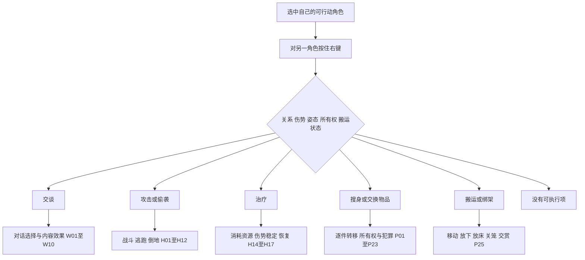

# 目标交互

[总索引与证据口径](behaviour-map.md)。默认 **Observed**，依据已有[短按分支](ui-input.md#quick-right-click-on-a-character)、[菜单条件](ui-input.md#context-menu-verbs)；不是当前 Meitou 菜单的转录。
菜单项是条件集合，不是所有目标通用的固定清单。中英文菜单词只用于识别动作。

## 输入与人物

| ID | 目标与前提 | 可做什么 → 发生什么 | 后续分支 |
|---|---|---|---|
| I01 | 选中自有单位，短按右键人物 | 按关系、伤势、倒地、潜行、对话等条件选择默认动作，或无动作 | 不能把“点了人物却不能交互”自动转成地面移动 |
| I02 | 对目标按住右键 | 打开适用动作及部分成功率；移到条目松开执行 | 松开在非条目处关闭；具体手势与特殊目标见输入文档 |
| I03 | 多选、动物选中、操作者不可行动 | 可用项和接令对象受限制 | 同令可能分给全选或单个执行者；全员昏迷不能照常执行 |
| I04 | 有可包扎伤势的角色 | First Aid → 接近、使用医疗资源、处理伤口 | 止血后仍需恢复；死亡不因包扎复活，见 H14 |
| I05 | 有机械伤势的角色 | Repairs → 接近并进行机械维修 | 需要对应修理资源；磨损与维修床见 H17 |
| I06 | 可夹板处理的伤肢 | Splint Injuries → 施加夹板效果 | 暂时改善可用程度；不能替代缺失肢体或瞬间治愈 |
| I07 | 自己或队友，满足可搬运条件 | Pick Up / Put Down → 建立或解除搬运关系 | 可移动、救援、放床、关笼；携带影响行动，见 H13 |
| I08 | 其他派系角色，可绑架 | Kidnap → 接近并尝试搬走，可能失败或被发现 | 成功转搬运；犯罪、追击、拘押见 P23–P29 |
| I09 | 可攻击的敌人 | Attack Target / Attack All → 建立攻击目标并接战 | 攻击、格挡、倒地或撤退；Attack All 的目标范围仍待实机核对 |
| I10 | 尚未敌对的角色 | Attack Unprovoked → 主动发起攻击 | 引出犯罪、关系和旁人反应；不是无代价的普通点选 |
| I11 | 可偷袭角色，操作者潜行等条件满足 | Stealth KO → 接近并尝试击昏 | 成功可搬运/搜身；失败可能暴露、追逐或开战 |
| I12 | 可交谈角色 | Talk To → 接近并进入该角色对话 | 选择回答、贸易、招募或其他效果，见 W01–W10 |
| I13 | 可跟随角色 | Follow → 持续跟随目标 | 目标移动就继续跟随；取消、丢失目标及队形需检查 |
| I14 | 可保护角色 | Bodyguard → 跟随并保护目标 | 被保护者遭攻击时介入；与单纯 Follow 分开 |
| I15 | 队友、尸体、倒地/睡眠/囚禁的他人 | Trade / Loot → 接近并打开相应物品窗口 | 实际转移才改变物品；非法取物可能触发偷窃，见 P01–P23 |
| I16 | 正由玩家角色背着的人物 | Put Down → 解除搬运并放到地面 | 被放下者按自己的伤势恢复、倒地或行动 |
| I17 | 选中正在保持低姿态的角色 | Stand Up → 尝试起身 | 肢体与昏迷状态仍约束行动；不是任何倒地都能强制站起 |
| I18 | 戴有锁住镣铐的人物/物品 | Unlock Shackles / Use Tools / Use Strength → 解锁、切断或破坏 | 成功可脱去镣铐；奴隶/逃奴身份不必同时消失，见 P28 |
| I19 | 被囚禁角色及其笼子 | Escape / Set Free / Pick Up，视锁与所有权开放 | 解锁不等于已逃离；放人可能触发守卫反应 |
| I20 | 自有房屋或城镇内符合条件的人物 | Throw out of home / Throw out of town → 搬离指定区域 | 不是通用杀死/删除人物；范围及完成点 **Unknown** |

## 建筑、设施与物品

依据另见：[门锁与床笼](locks.md)、[建造生产](buildings-production.md)、[炮塔](combat.md#turrets)、[搬运](carry-loot.md)。

| ID | 目标与前提 | 可做什么 → 发生什么 | 后续分支 |
|---|---|---|---|
| I21 | 未完成建筑 | Build → 接近工位、供料并施工 | 缺料等待/寻找材料，完成后开放建筑功能，见 B09 |
| I22 | 损坏建筑、废屋 | Repair → 进行修复 | 资源与所有权限制；修好后恢复使用 |
| I23 | 可用机器、矿点、农田 | Use 或目标默认操作 → 执行该设施的工作 | 材料、工位、输出、电力制约，见 B13–B27 |
| I24 | 自有库存、储物/自动设备 | Inventory / Auto-Haul → 打开库存或搬运 | Shift 可产生支持的常驻工作；打开库存本身不生产 |
| I25 | 空床或修理床 | Sleep；背着角色时 Put in Bed → 入床休息/治疗 | 床位、租金、种族/机械类型、电力按床种类检查 |
| I26 | 空笼、有人笼、自有或他人笼 | Get in / Put in / Set Free，及适用 Lock / Unlock | 进入、关押或释放；锁、占用、所有权决定可用项 |
| I27 | 训练设施 | Training → 占用设施训练 | 到训练上限、离开或被打断；不是无限通用加经验 |
| I28 | 炮塔及已操炮角色 | Man Turret → 操炮；Shoot At → 指定射击目标 | 可射击、换目标、离岗；弹种、电力、射界见 H06 |
| I29 | 尸体处理设施 | Corpse Disposal → 搬运并处理符合条件的尸体 | 自动搜集是另一工作分支；不能把活人当普通尸体处理 |
| I30 | 自有且可拆建筑 | Dismantle → 拆除及材料返还规则生效 | 清空位置、重建；返还比例与库存处理查主题文档 |
| I31 | 未锁门 | Open / Close；自有门可 Lock | 通行与寻路变化 |
| I32 | 锁住的门、容器或笼子 | 自有 Unlock；否则 Pick Lock / Use Tools / Use Strength，门可有 Smash | 成功后可打开、搜物或出入；权限与被发现影响犯罪 |
| I33 | 地面物品 | Pick Up / Steal → 走近并取物 | 进包或受空间/权限限制；普通地面物不保证有右键菜单 |
| I34 | 可搜查容器 | Inventory / Loot → 接近、满足锁条件后开库存 | 转移、盗窃、关闭窗口；不是直接“全部拿走” |

## 一个右键链条

各边都受前提限制；图中并列项不代表会同时出现。
**Unknown**：混合人兽多选、多人搬同一目标、目标在菜单打开后醒来/死亡/换派系、床笼双菜单的全部呈现与执行规则。
标签表里存在 Stealth Kill 等名称不能证明正常原版可用；没有可达入口证据的标签不算已确认能力。
